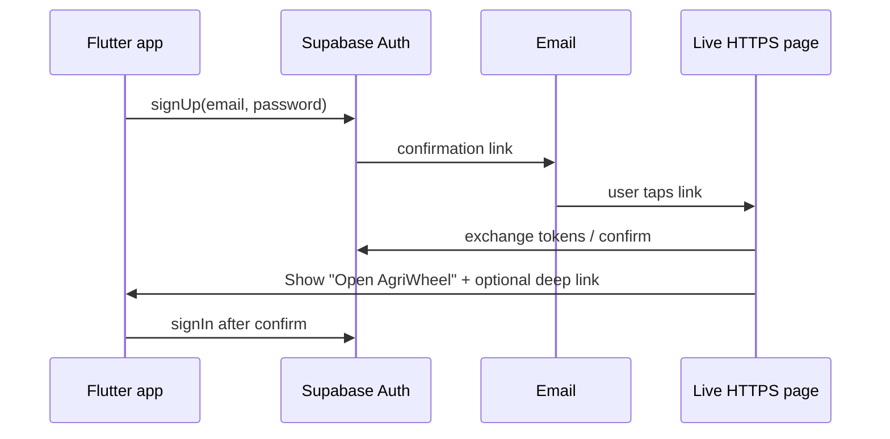

# Live email confirmation + admin (free tier)

AgriWheel stays on **Supabase Free** (your project: Nano / `iaycghsiuwfwmbskzeri`). No paid add-ons required for auth, DB, storage, or a small public web page.

---

## Can you “host live on Supabase”?

| What | On Supabase Free? |
|------|-------------------|
| Database, Auth, Storage, Realtime | **Yes** (already) |
| Built-in **Dashboard** (Table Editor, SQL, Users) | **Yes** — this is *your* operator panel, not an end-user admin UI |
| Public website (email confirm page, admin SPA) | **No** — Supabase is not a web host. Use a **free static host** (Vercel, Netlify, Cloudflare Pages, GitHub Pages) that points at HTML in this repo |
| Custom “AgriWheel Admin” for moderators | **Build separately** (web app in repo), still talks to **same** Supabase project |

**Never** put the `service_role` key in the mobile app or public admin front-end. Use **anon key + RLS** and an `admin` flag on `profiles` (or a small `admins` table) for moderator actions.

---

## Part 1 — Email confirmation **live** (keep confirm ON)

### Why localhost broke

With **Confirm email** ON, the link in the email uses **Site URL** (default `http://localhost:3000`). Nothing runs there → `ERR_CONNECTION_REFUSED` or `otp_expired`.

### Target flow (production-style)



### Step A — Add a live page in this repo (planned folder)

Create and deploy:

```text
web/
  auth/
    index.html      # "Email confirmed" + handles #access_token from Supabase
    config.example.js   # SUPABASE_URL only (anon key is public like the app)
```

Deploy **only** `web/auth/` (or whole `web/`) to free hosting:

- **Vercel** or **Netlify** (recommended): connect GitHub, root = `web/auth`, free HTTPS subdomain e.g. `agriwheel-auth.vercel.app`
- Or **Cloudflare Pages** / **GitHub Pages**

### Step B — Supabase dashboard (you do once)

**Authentication → URL configuration**

| Field | Example value |
|--------|----------------|
| **Site URL** | `https://agriwheel-auth.vercel.app` (your real deployed URL) |
| **Redirect URLs** (add all) | `https://agriwheel-auth.vercel.app/**` |
| | `io.supabase.agriwheel://login-callback/**` (optional, for app deep link later) |

**Authentication → Providers → Email**

- Keep **Confirm email** ON if you want that flow.

**Authentication → Email templates**

- Optional: edit “Confirm signup” body to say “Open the link, then return to the AgriWheel app and log in.”

### Step C — Flutter app (when we implement Part 1 code)

In `AuthRepository.signUp`, set:

```dart
emailRedirectTo: 'https://YOUR-LIVE-DOMAIN/auth/', // must be in Redirect URLs
```

After confirm, user opens app → **Login** with same email/password (session is not auto-created on phone until they sign in, unless you add deep links).

### Step D — Optional: deep link back into app (Phase 2.5)

- Android: intent filter for `io.supabase.agriwheel`
- iOS: URL scheme in `Info.plist`
- Add same scheme to Supabase **Redirect URLs**

Confirm page can show button `agriwheel://login` after success.

### Free tier impact

- Auth emails: included in Free (within monthly auth limits).
- One static page on Vercel/Netlify: **$0**.

---

## Part 2 — Admin panel (separate from mobile app)

Your mobile spec caps at **20 screens** — **moderator admin is not inside the Flutter buyer/seller app**.

### What Supabase Dashboard already gives you (free)

Use today for development:

- **Authentication → Users** — confirm/delete users
- **Table Editor** — edit `profiles`, `listings`, set `is_featured`, `is_verified`
- **Storage** — view `verification-docs`, `listing-images`

That is enough until you have real moderators who are not developers.

### When you need a real “Admin panel”

A small **web-only** app in the repo, e.g.:

```text
admin_web/          # Flutter web OR simple HTML/JS — later phase
  lib/ or src/
  uses anon key + login as admin user
```

**Features (minimal MVP):**

1. Login (same Supabase email/password; `profiles.role = 'admin'` or `is_admin` column — add in SQL when ready)
2. List pending sellers / CNIC uploads
3. Toggle `profiles.is_verified`
4. Toggle `listings.is_featured`, archive bad listings

**Security model (free, no Edge Functions required at first):**

```sql
-- future migration (not in app yet)
alter table public.profiles add column if not exists is_admin boolean not null default false;
-- RLS: only is_admin = true can update is_verified on others, etc.
```

Moderators log in with normal Auth; RLS allows extra `update` only when `auth.uid()` has `is_admin`.

### Can admin “live on Supabase”?

- **Backend:** yes, same Free project.
- **UI:** deploy `admin_web` build to second free site e.g. `agriwheel-admin.vercel.app` (or password-protect with Vercel).
- **Do not** expose `service_role` in that UI.

---

## Part 3 — Recommended order

| Order | Task | Cost |
|-------|------|------|
| 1 | Deploy `web/auth/index.html` → get HTTPS URL | Free |
| 2 | Set Supabase Site URL + Redirect URLs | Free |
| 3 | App `emailRedirectTo` + test sign-up email → page shows success | Free |
| 4 | Continue **Phase 3** mobile (listings) | Free |
| 5 | Use Dashboard as admin until listings volume grows | Free |
| 6 | Add `admin_web` + `is_admin` RLS when you need non-dev moderators | Free |

---

## Part 4 — Staying on Free (practical limits)

Supabase **Free** (typical limits — check dashboard for current numbers):

- Database size, storage, egress, **monthly active users** for Auth
- **Nano** compute pauses after inactivity (first request may be slow)

For AgriWheel MVP (Pakistan marketplace, early users): Free is enough if you:

- Compress listing images (~300 KB each)
- Paginate home/search (20 per page)
- Do not run heavy analytics on DB

Upgrade only when dashboard warns you or cold starts hurt production.

---

## What you should do **now** (manual)

1. Pick a host (Vercel is fine).
2. After we add `web/auth/index.html`, deploy it and copy the HTTPS URL.
3. Supabase → **URL configuration** → set **Site URL** to that URL (not localhost).
4. Re-send confirmation or register a **new** test email.
5. Keep using **Table Editor** as your admin until Phase “admin_web”.

Say **“implement live auth page”** when you want the `web/auth` files + `emailRedirectTo` wired in Flutter.
